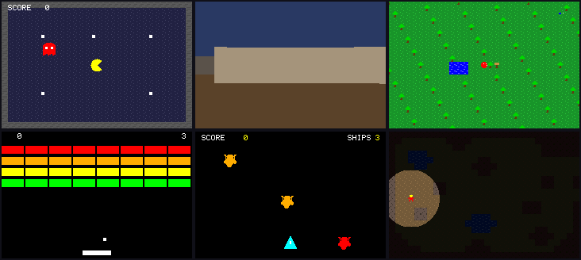

# VBlank

**Write a 2D retro game in plain Ruby, and build it for the consoles it was made for.**



> Six of the [examples](examples/), each a real Game Boy Advance cartridge running in an emulator.

You write Ruby. VBlank turns it into a cartridge that boots on the real console or in any emulator, and the same game can also be a program for a computer or a page in a browser. The framework manages the machine: no video memory, no registers, no assembly. The language is about 2D games today: tiles, sprites, layers and a painted screen.

VBlank began as a way to learn, and it has grown into a multi-console engine for real games. The proof of that is porting real games to it, and those ports decide much of what gets built next.

The toolchain is shaped around fast, readable feedback while building a game, for a person or an agent. The language has grown large, with many options on its verbs.

## Where a game runs

| Target | Status |
|---|---|
| Game Boy Advance | Fairly robust. Every feature works here, and it is what the examples are written for. |
| Super Nintendo | Underway. Most of the examples build for it, with sprites, backgrounds and sound. Some music features and a second player are still to come. |
| Sega Genesis | Early. Painted screens, tiled screens with backgrounds (a scene's own included) and sprites, the buttons, lists and timers, fades and tints, collision, the camera on a painted screen, and sprites and backgrounds drawn in other colours work; sound, saves, the status bar, backgrounds bent row by row, tiles painted from a list and screens that change between painted and tiled do not yet. Played in Genesis Plus GX to check it. |
| Game Boy Color | Underway. Much of the language works, and several of the examples build for it. |
| A program for a computer | Works, built from the game as C. The Mac build is played and tested; Windows and Linux builds are made but not yet run on those systems. |
| A web page | Works, built from the game as JavaScript. One file that opens from a disk or any web server. |
| A window, in Ruby | Works, with some features still to come. `vblank run` plays the game on Ruby and SDL3, with no compiler. |

Every game says which consoles it is for, and a build makes a cartridge for each one. What a console cannot do is refused at build time, in plain words, so a game either plays the same there or does not build.

## A first game

```ruby
require "vblank"

Walk = VBlank.game "WALK", consoles: %i[gba gbc] do
  screen :bitmap
  x = 40
  y = 40

  game_loop do
    x -= 1 if held(:left)
    x += 1 if held(:right)
    y -= 1 if held(:up)
    y += 1 if held(:down)

    clear_screen :black
    draw_text "WALK", :center, 8, :white
    draw_rect_at x, y, 8, 8, :yellow
  end
end

Walk.write_if_main
```

```bash
vblank new pong                            # write a starter game to pong.rb
vblank build walk.rb                       # walk.gba and walk.gbc, beside the game
vblank build walk.rb --console gbc         # the Color's cartridge alone
vblank build walk.rb --format=native       # a program for this computer
vblank build walk.rb --format=web          # walk.html
vblank run walk.rb --browser               # play it in a browser; every reload rebuilds it
vblank run walk.rb                         # play it in a window, in Ruby
```

`vblank` also plays a game from a script with nobody at the controls (`play`), finds where two builds of a game start to differ (`compare`), and measures where a cartridge's frames go (`profile`). `vblank help` lists every command.

## How it works

**Mistakes explain themselves.** The worst part of working on an old console is that a mistake rarely says what went wrong — you get a black screen, or garbled pictures, or a crash far from its cause. VBlank checks the game before it builds and says what happened and how to fix it: *drew something but never chose a screen*, *a game loop that never waits for the screen*, *a comparison used as a Ruby `if`*. A serious problem stops the build; a smaller one prints a warning. Fixes are suggested, never made silently.

**One description of the game, many targets.** The language does not write machine code as it goes. Each verb records what the game does, and the whole game is checked before anything is made. A backend then turns that description into its target: an Advance, Color or Super Nintendo cartridge, C, JavaScript, or Ruby. A Ruby interpreter runs the same description too, and it is the answer every target is tested against. A new console is a new backend, not a new language.

**Add verbs without touching the compiler.** A game can register a module of its own verbs, written in the same verbs it already uses, and from then on they read like the built-in ones. Because such a verb is made only of other verbs, it works on every target the day it is written. Screen shake and fades ship this way: see [`lib/vblank/effects/packs/`](lib/vblank/effects/packs/).

**See where the time went.** `rom.profile` (or `vblank profile game.rb`) shows what the build made and where a running cartridge spent its frames, routine by routine, measured in the emulator rather than estimated. The build uses the same measurement to choose which routines go in the console's fastest memory.

## Testing a game

A game's tests play it through the library's test helper, and each test runs on every target the game is for, compared frame by frame against the interpreter:

```ruby
require "vblank/testing"

class Minitest::Test
  include VBlank::Testing
end

def test_holding_right_walks
  played = game_player.hold(:right).run(Walk.program, frames: 6)
  assert_equal 46, played[:x]
end
```

In the game's Rakefile, `require "vblank/testing/rake_tasks"` and `VBlank::Testing::RakeTasks.new` give it a `rake test` that does this. The comments in [`lib/vblank/testing/`](lib/vblank/testing/) describe the rest.

## Examples

Every file in [`examples/`](examples/) is a complete game or demo that teaches one idea, and its header comment explains the hardware it touches. Build any of them with `ruby examples/<name>.rb`. Good places to start:

- [`pong.rb`](examples/pong.rb) — paddles, a ball, collision, scoring, music and a title menu.
- [`pacman.rb`](examples/pacman.rb) — a tiled maze, sprites, a chasing ghost and a live score; it builds for all three consoles.
- [`breakout.rb`](examples/breakout.rb) — a wall of bricks, lives and scenes on a screen that never tears.
- [`shmup.rb`](examples/shmup.rb) — a game split across files, with a play, game-over and restart flow.
- [`raycaster.rb`](examples/raycaster.rb) — a first-person maze, drawn the Wolfenstein way.

## Using it in a game

Building a cartridge needs only Ruby. Checking or measuring one runs it in an emulator, through the `ruby-gba-emulator` gem, which lives in this repository but is not a dependency, so somebody who only builds cartridges needs no C compiler. Add both to a game's Gemfile in one block:

```ruby
git "https://github.com/vblank-rb/vblank.git", glob: "{,ruby-gba-emulator/}*.gemspec" do
  gem "vblank"
  gem "ruby-gba-emulator"
end
```

Keep it as one block. Two separate `gem ... github:` lines look the same but are two sources that clone into one folder, and the clone fails.

| To… | you need |
|---|---|
| build a cartridge, or run a game in the interpreter | Ruby |
| build a web page, or `vblank run --browser` | Ruby, and a browser to play it |
| play a game in a window, `vblank run` | SDL3, and `gem "fiddle"` in the game's Gemfile |
| build a program for a computer | zig 0.17 |
| import a picture from a PNG | ImageMagick (`.aseprite` files are read in Ruby) |
| test a game as JavaScript | node 18 or later |
| check or measure a cartridge | `ruby-gba-emulator`: a C compiler and libmgba |

## Status

Pre-1.0. Full games work end to end on the Game Boy Advance, and every other build is checked against the same answers, frame by frame or pass by pass. The Super Nintendo and the Game Boy Color are catching up.

## Where it is headed

**More consoles, closer to what each can do.** The near work is bringing the Super Nintendo and the Color up to the Advance. A new console is a new backend, and the same game goes with it.

**Real games as the proving ground.** Ports live in their own repositories, and they find most of the gaps still to close: a Wolfenstein 3D port, [ruby-wolf3d](https://github.com/jamescook/ruby-wolf3d), and a port of The Legend of Zelda: The Minish Cap, which is underway and not public yet.

**Ports that an agent can drive.** So far each port has been a long session held to a few rules: follow the original game, match how it behaves, work in small pieces. Those rules are close to a method, because the original can say what is right and the first real difference names the next piece of work. The plan is a separate tool that runs that loop, with an agent doing the porting and a person supervising. It is not built yet.

## The name

VBlank is the pause after every frame, when the screen has finished drawing and it is safe to change the picture. Every machine a game here runs on has one.
